# OSPF Troubleshooting Lab 1

**Troubleshooting ticket:**

Customer has told you that Router1 is not able to ping the loopback of Router4. 
**Your job:** Identify the problem and restore connectivity!

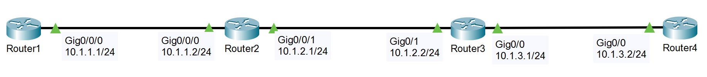
**[Download the Packet Tracer Lab](OSPF%20TS%20LAB%201.pkt)**

## Identifying the Problem and Restoring Connectivity

1. Pinging R4's loopback address (`4.4.4.4`) failed. `show ip route` confirm that R1 had no route to R4's loopback address (`4.4.4.4`).

   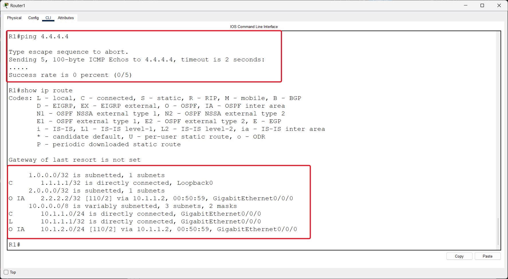

   R1 had formed a FULL adjacency with R2 only, as shown in the `show ip ospf database` output.

   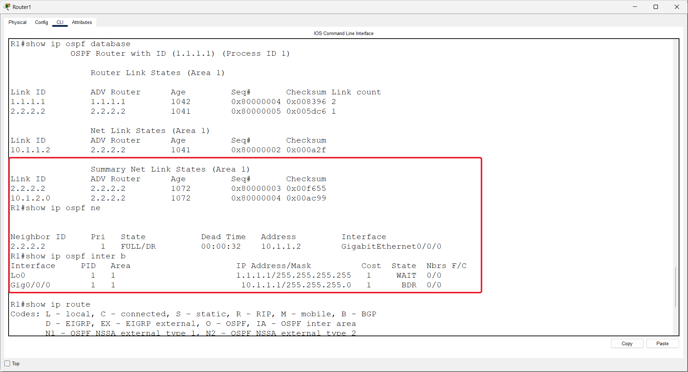

2. On R2, the interface facing R3 was configured in OSPF Area 1. R2 was only aware of R1, and no OSPF neighbor adjacency was forming with R3.

   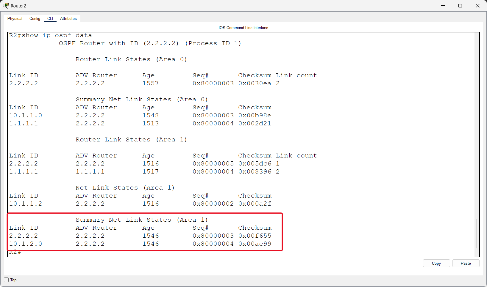

   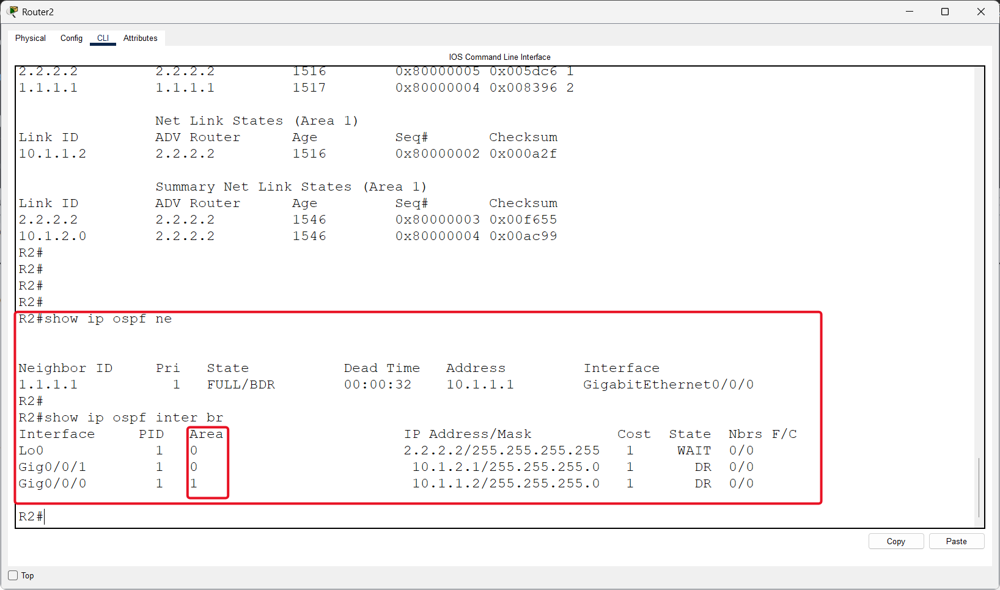

3. R3 was only aware of R4, and no OSPF neighbor adjacency was forming with R2.

   R3's GigabitEthernet0/1 interface facing R2 was configured in Area 2, while R2's GigabitEthernet0/0/1 interface was in Area 1.

   **Root cause:** The OSPF area mismatch prevented R2 and R3 from forming a neighbor adjacency.

   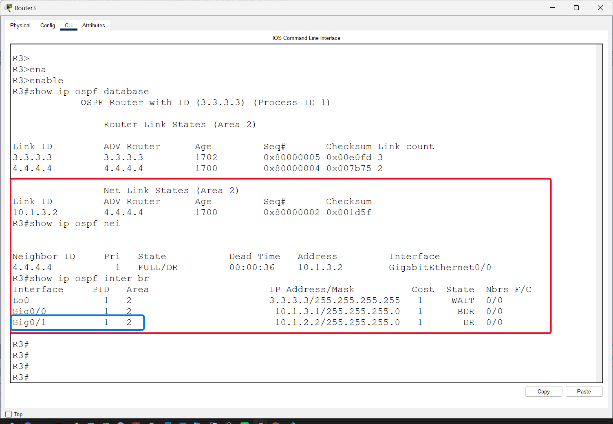

4. Going back to R2, I changed the OSPF area of interface `GigabitEthernet0/0/1` from Area 1 to Area 2.

   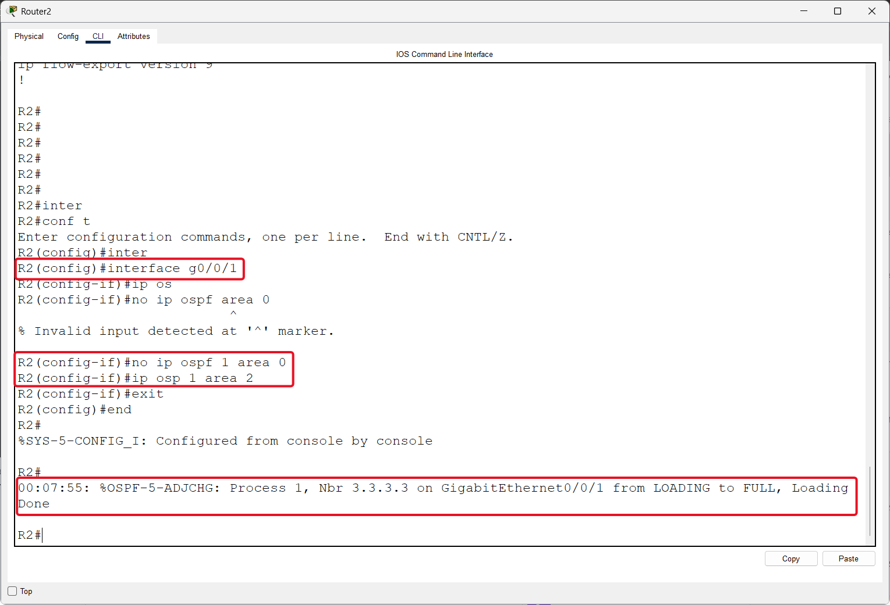

5. After correcting the area mismatch, the OSPF neighbor adjacency was successfully established between R2 and R3. and R3 & R4's ID was also visible in the OSPF database.

   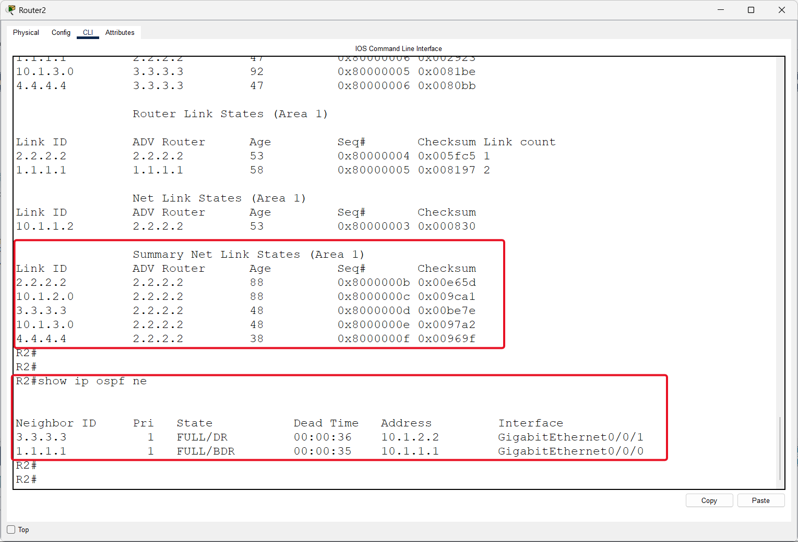

6. R1 now lists R3 and R4 in the `show ip ospf database` output.

   The `show ip ospf border-routers` command also showed that R2 was acting as an Area Border Router (ABR).

   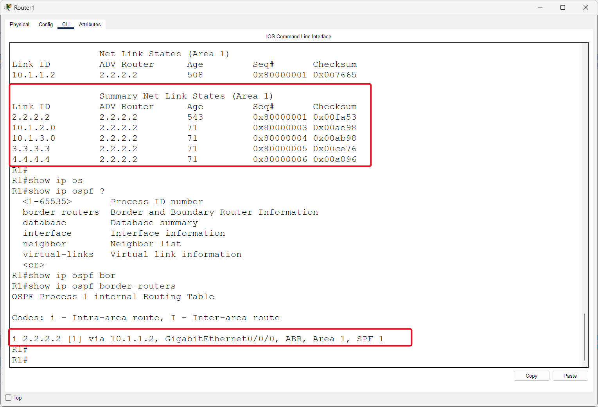

7. The `show ip route` command confirmed that R1 now had a route to R4's loopback address (`4.4.4.4`).

   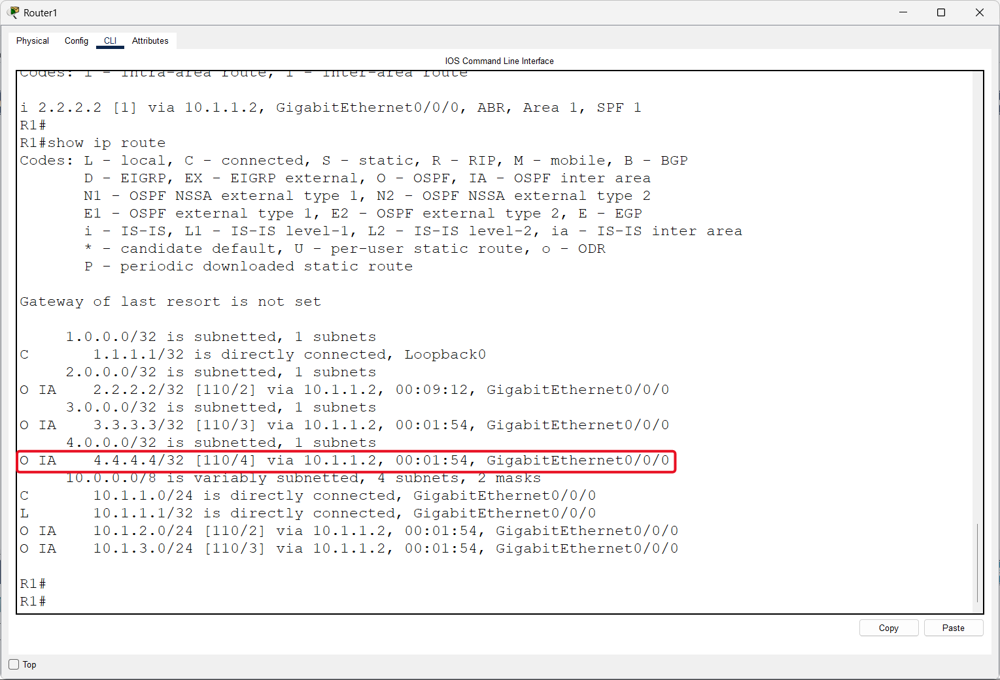

8. Pinging both R3's loopback address (`3.3.3.3`) and R4's loopback address (`4.4.4.4`) was successful.

   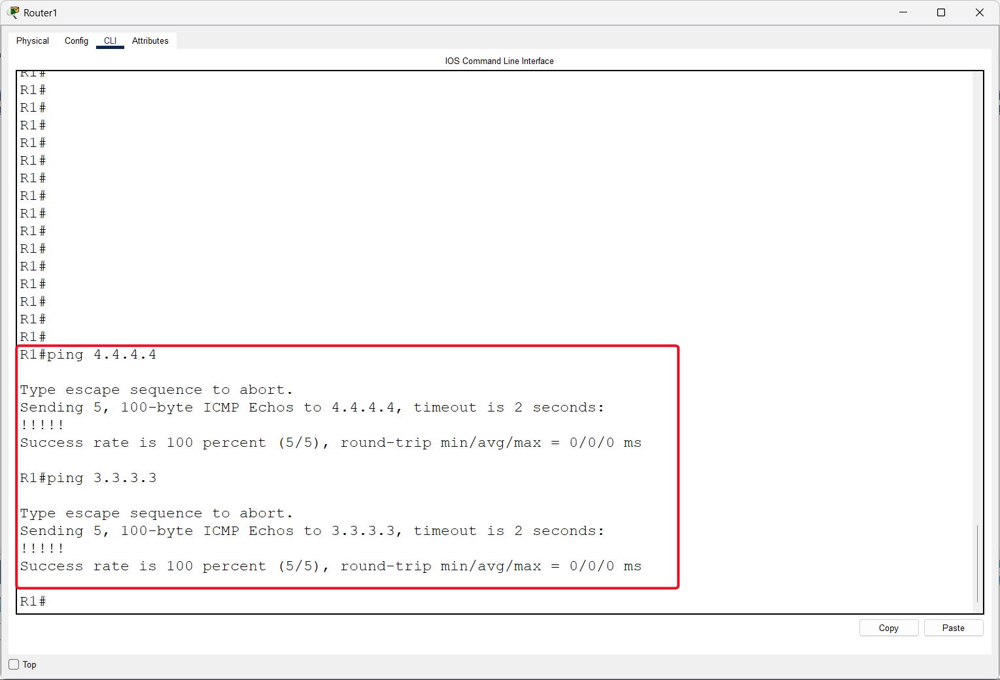

The issue has been resolved.

**[Next Lab →](../OSPF%20TS%20LAB%202/)**
