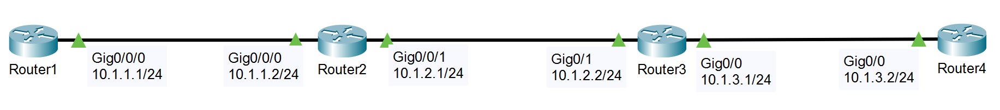
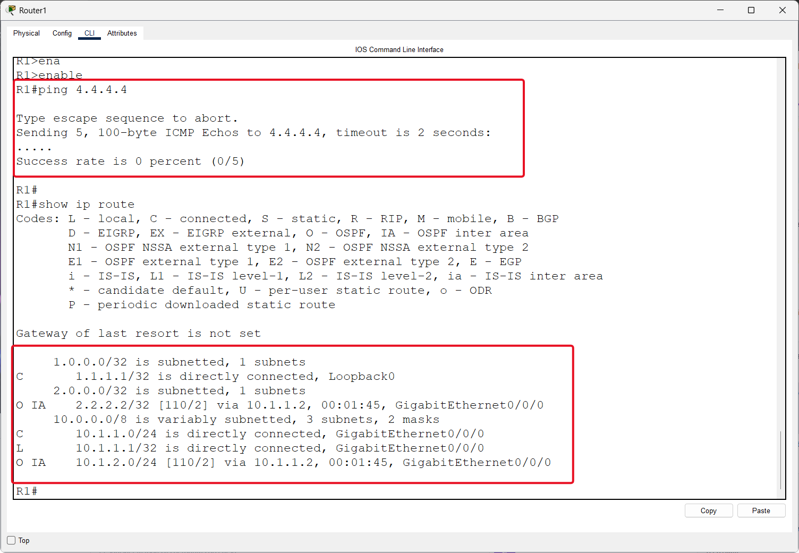
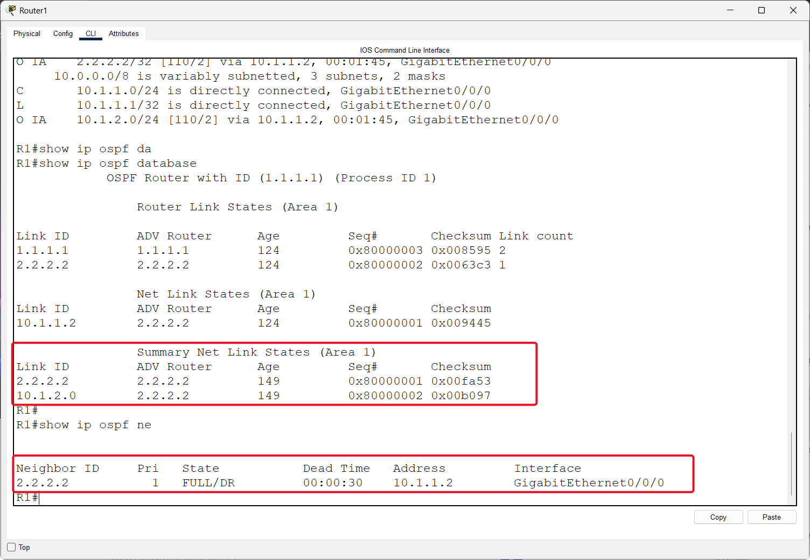
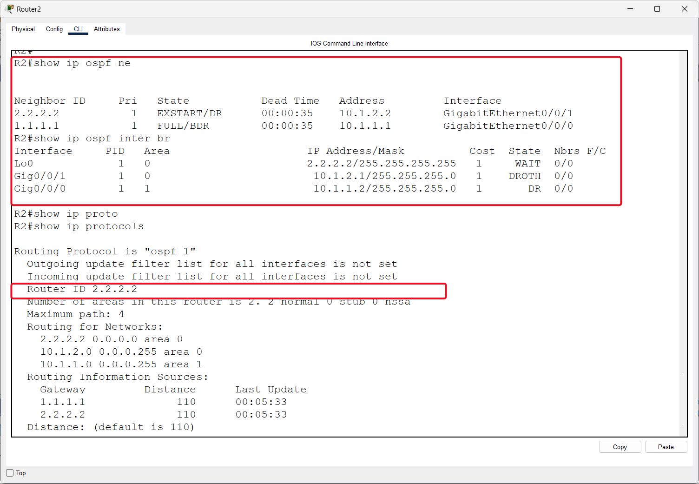
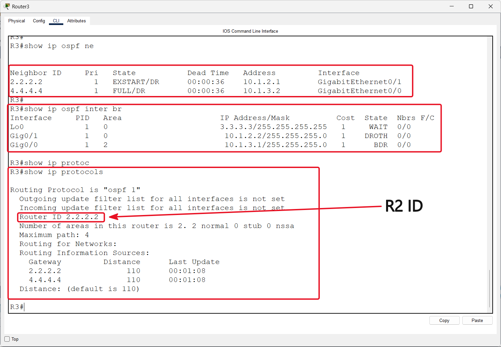
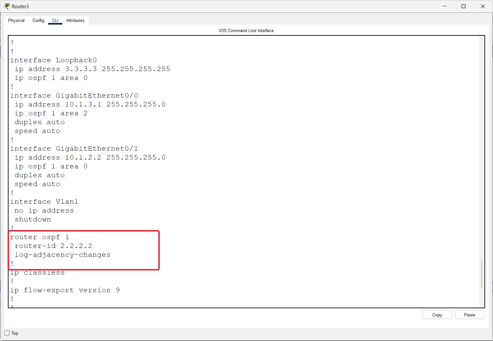
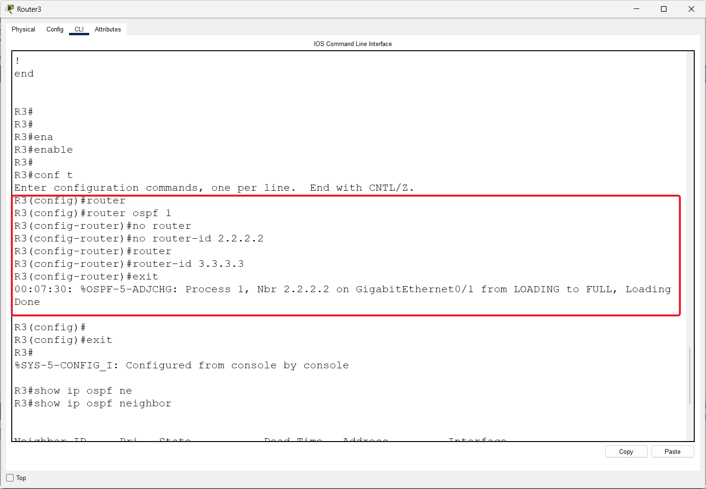
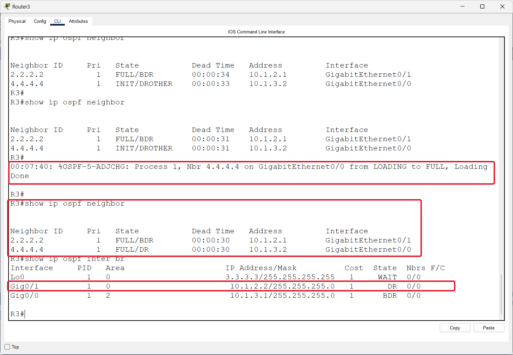
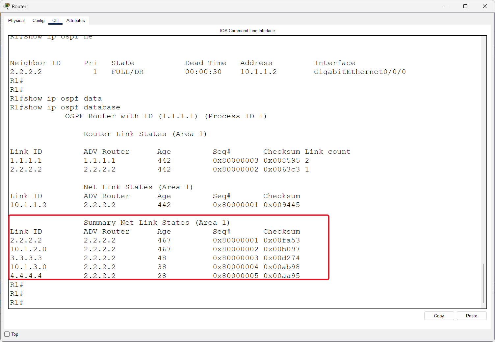
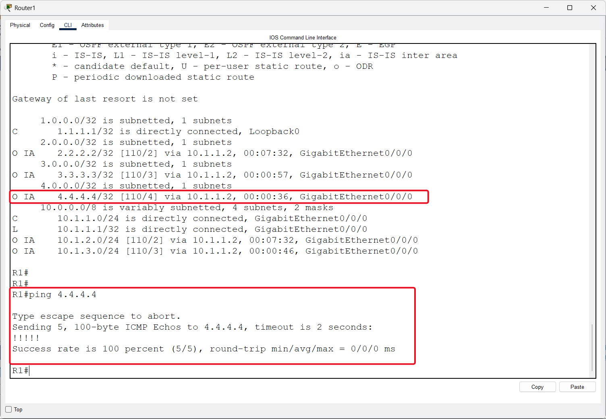

# OSPF Troubleshooting Lab 2

**Troubleshooting ticket:**

Customer has told you that Router1 is not able to ping the loopback of Router4. 
**Your job:** Identify the problem and restore connectivity!

**[Download the Packet Tracer Lab](OSPF%20TS%20LAB%202.pkt)**

## Identifying the Problem and Restoring Connectivity

1. Pinging R4's loopback address (`4.4.4.4`) failed. The `show ip route` confirm that R1 had no route to R4's loopback address.

   

   The `show ip ospf database` command on R1 showed only R2 in the database.

   

2. On R2, the interface facing R3 showed a neighbor with Router ID `2.2.2.2`, which was the R2's Router ID itself. The OSPF adjacency was stuck in the ExStart state.

   

3. On R3, the `show ip ospf neighbor` command showed R4 and R2 as neighbors and The OSPF adjacency was stuck in the ExStart state. However, R3's own OSPF Router ID was also `2.2.2.2`, which was a problem.

   

   **Root cause:** R3 had the same OSPF Router ID as R2. The duplicate Router ID prevented R2 and R3 from forming a full neighbor adjacency.

   

4. I changed R3's OSPF Router ID to `3.3.3.3`.

   

5. R3 successfully formed a FULL adjacency with R2.

   

6. R1 now lists R3 and R4 in the `show ip ospf database` output.

   

7. The `show ip route` command confirmed that R1 now had a route to R4's loopback address (`4.4.4.4`), and the ping was successful.

   

The issue has been resolved.

**[Next Lab →](../OSPF%20TS%20LAB%203/)**
