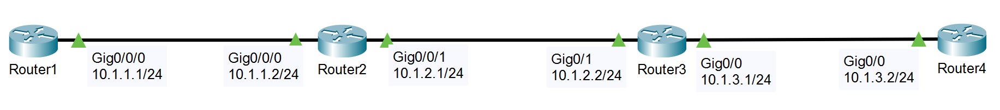
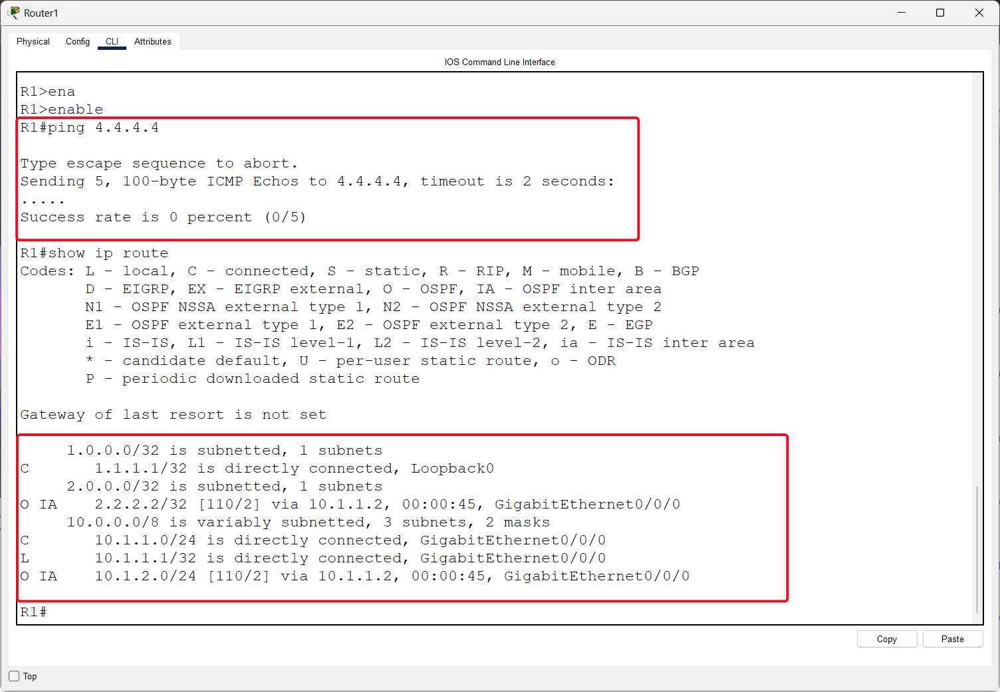
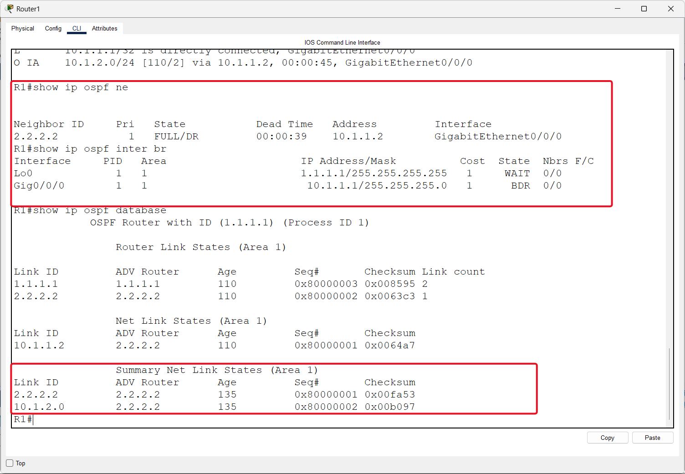
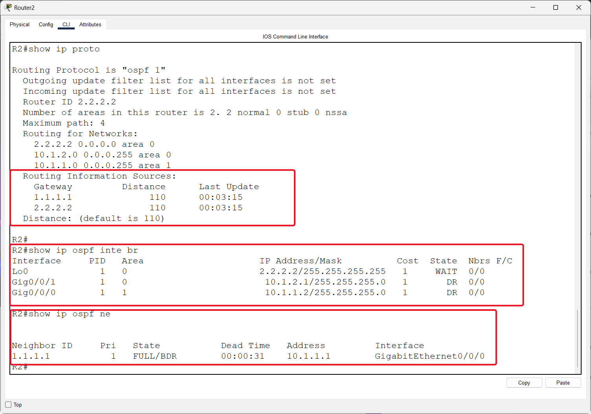
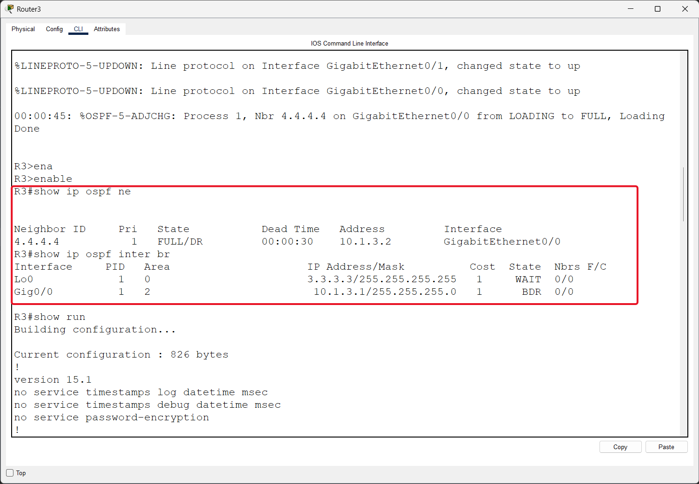
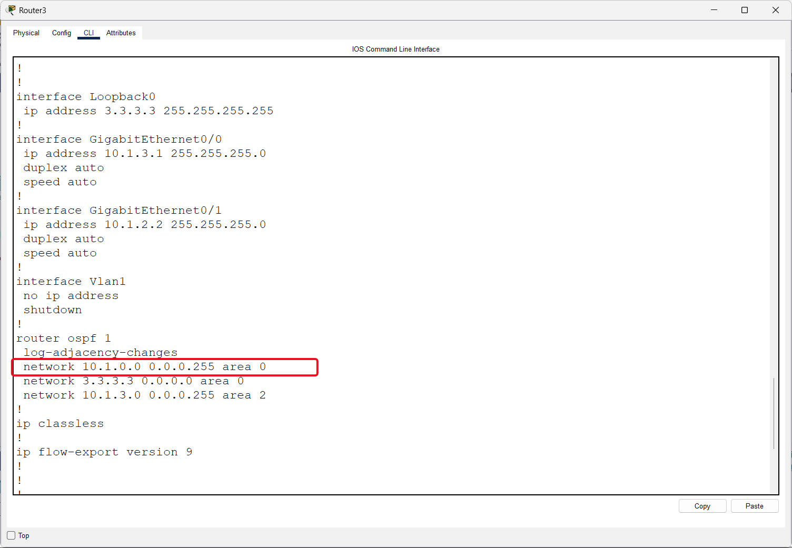
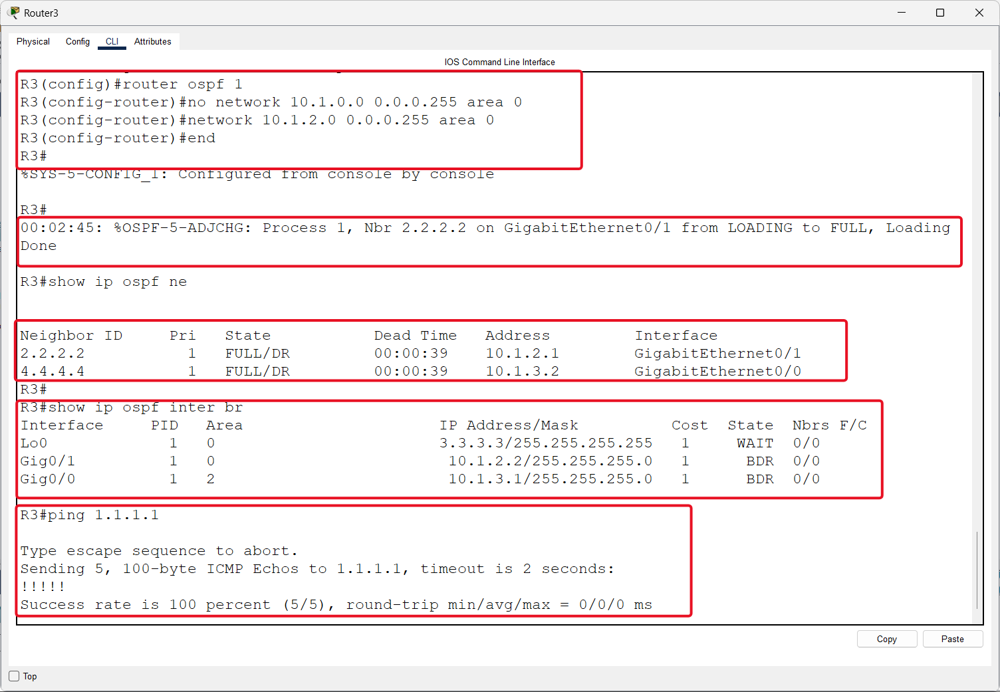
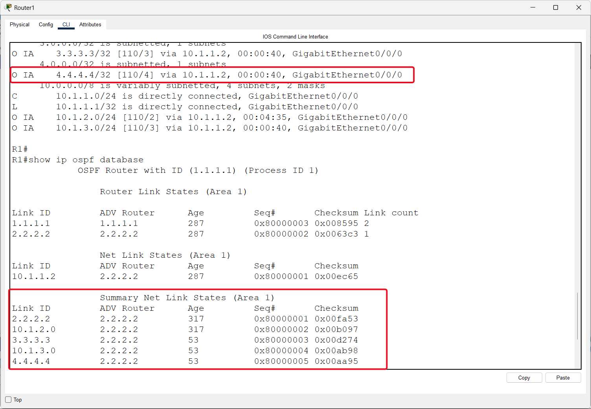
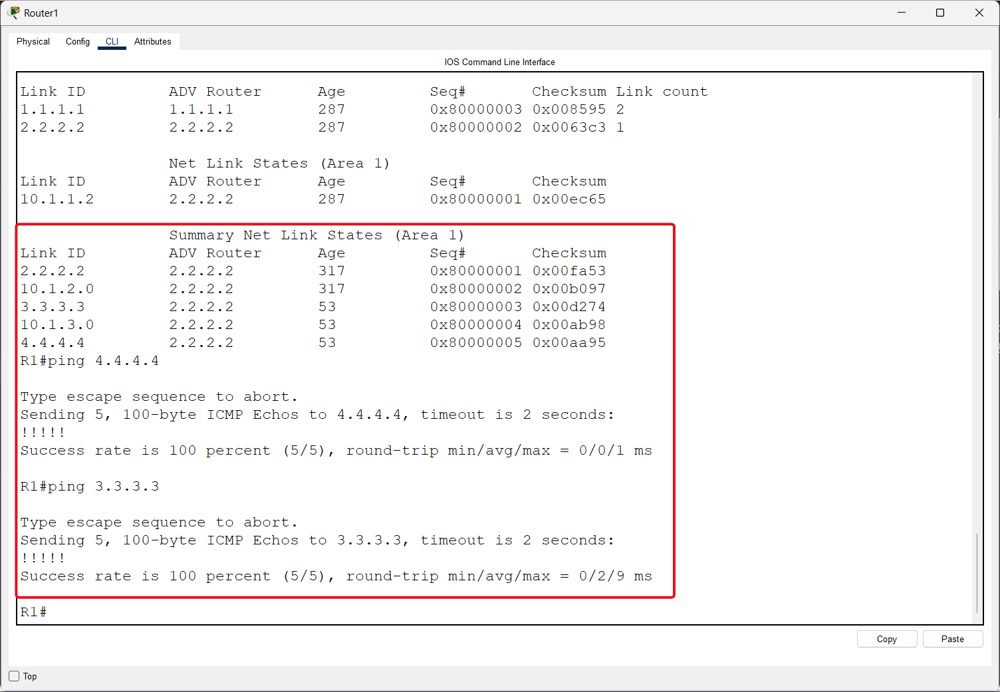

# OSPF Troubleshooting Lab 3

**Troubleshooting ticket:**

Customer has told you that Router1 is not able to ping the loopback of Router4. 
**Your job:** Identify the problem and restore connectivity!

**[Download the Packet Tracer Lab](OSPF%20TS%20LAB%203.pkt)**

## Identifying the Problem and Restoring Connectivity

1. Pinging R4's loopback address (`4.4.4.4`) failed. The `show ip route` confirm that R1 had no route to R4's loopback address or R3's network.

   

   R1's OSPF database only contained information about R2, with no information about R3 or R4.

   

2. On R2, the `show ip ospf neighbor` command showed only R1 as a neighbor.

   

3. R3 was only aware of R4, and no OSPF neighbor adjacency was forming with R2.

   

4. After checking R3's running configuration, I noticed that interface `GigabitEthernet0/1` had the IP address `10.1.2.2/24`.

   However, the OSPF was configured as `10.1.0.0 0.0.0.255`, which did not match the interface's IP address.

   **Root cause:** The incorrect OSPF network configuration prevented OSPF from being enabled on R3's interface facing R2, so no neighbor adjacency could form.

   

5. I corrected the OSPF network configuration on R3 to match the interface's network (`10.1.2.0/24`).

   

   After correcting the network statement, the OSPF neighbor adjacency was successfully established between R2 and R3, and R3 could successfully ping R1.

6. R1 now lists R3 and R4 in the `show ip ospf database` output. The `show ip route` confirm that R1 have a route to R4's loopback address (`4.4.4.4`).

   

7. Pinging both R3's loopback address (`3.3.3.3`) and R4's loopback address (`4.4.4.4`) was successful.

   

The issue has been resolved.

**[Back to All Labs](../)**
